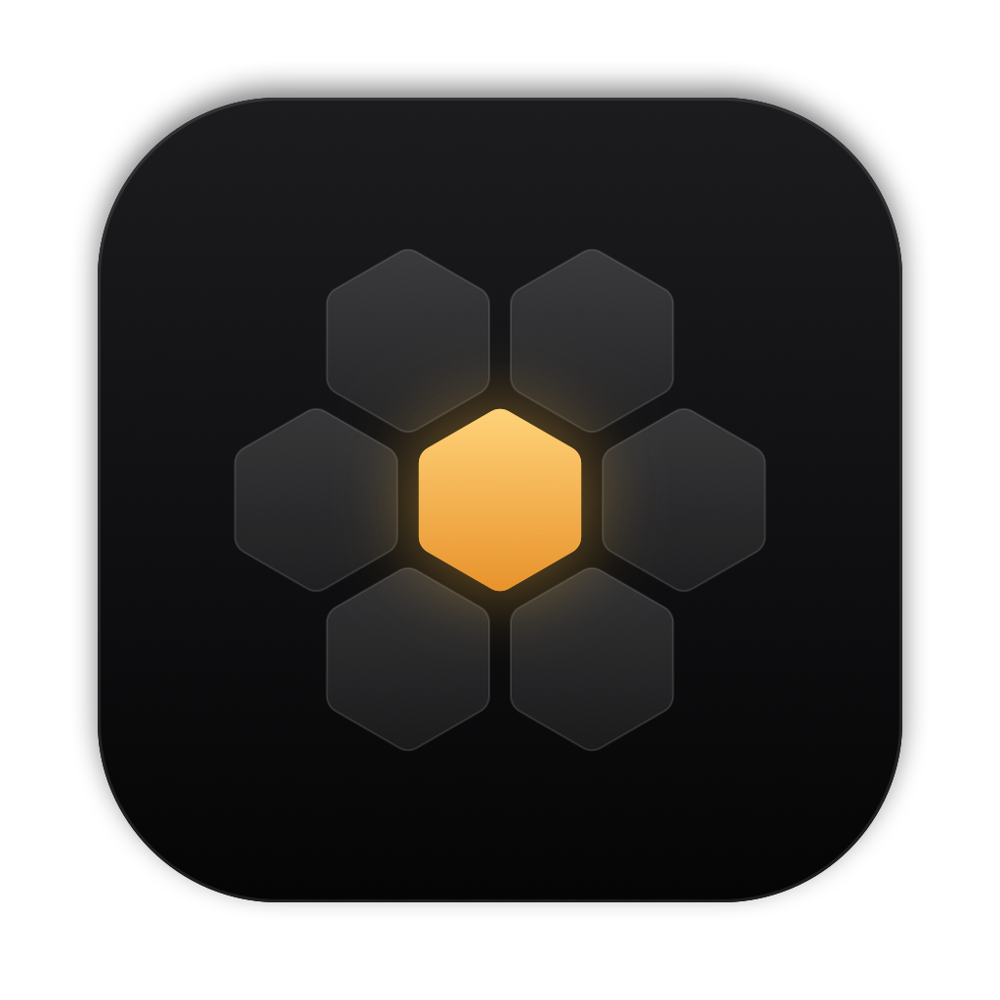
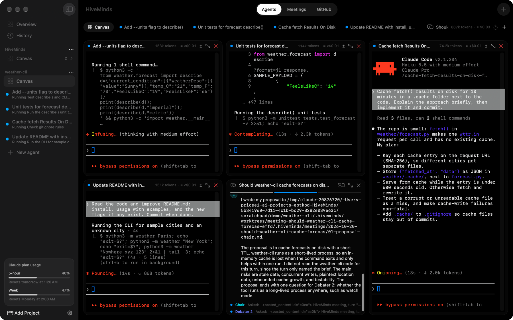
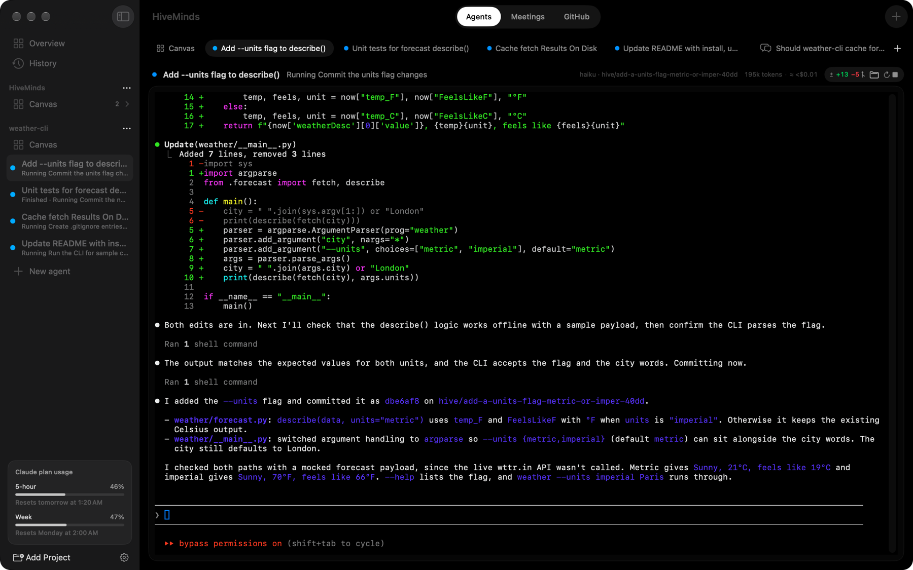
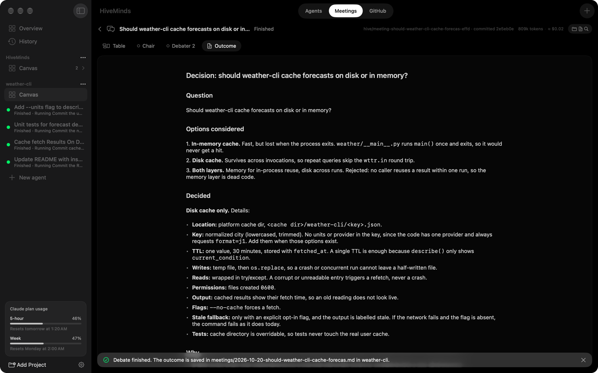
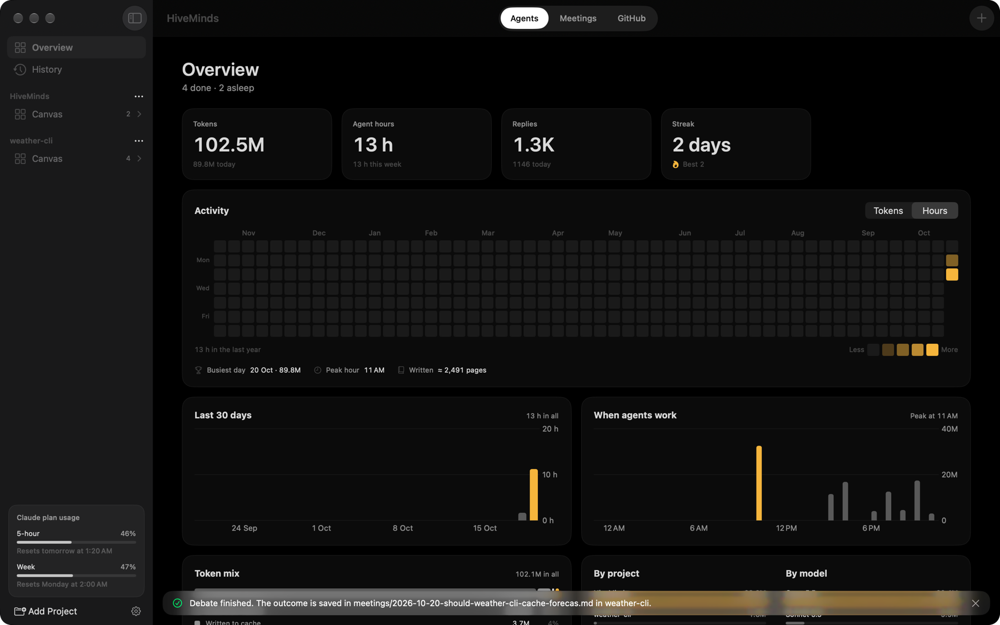
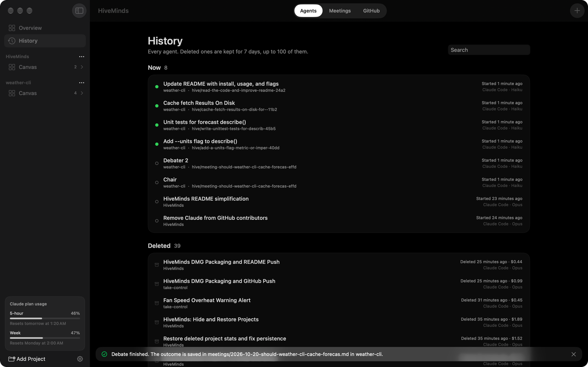

<p align="center">
  <picture>
    <source media="(prefers-color-scheme: dark)" srcset="branding/logo/wordmark-dark.svg">
    <source media="(prefers-color-scheme: light)" srcset="branding/logo/wordmark-light.svg">
    
  </picture>
</p>

<p align="center">A calm, native macOS app for running Claude Code and Codex agents across your projects.</p>

<p align="center">
  
</p>

<p align="center">
  <a href="https://github.com/eptkod/HiveMinds/releases/latest"><b>Download for macOS</b></a>
</p>

<p align="center">
  
</p>

## What it is

If you run more than one coding agent at a time, the terminal windows pile up fast. HiveMinds puts them all in one quiet, black window. Each project gets its own space, and you can see every agent working at once, step in when one needs you, and review what it changed before it goes anywhere.

## What you can do

### See everything at once

The **Canvas** shows every agent, browser tab and shell in a project side by side, and each one works right there. Drag tiles around, make the important ones bigger, and HiveMinds tells you (with a sound, if you like) when an agent finishes or needs an answer.

### Give each agent its own branch

An agent can work on its own copy of the project, so several can change code at the same time without stepping on each other. When it's done, look at what it changed, then let HiveMinds write the pull request. Nothing is pushed until you say so.

<p align="center">
  
</p>

### Hold meetings

Ask a few agents to debate an idea or review some code together. They take turns, and you get a written summary of what they agreed on.

<p align="center">
  
</p>

### Turn GitHub issues into work

Sign in with the GitHub CLI and HiveMinds lists the open issues across your projects. Pick one, and an agent starts on it. Its pull request closes the issue when it's merged.

### Keep an eye on cost

Every agent shows its tokens and an estimated cost. The Overview charts your activity, and you can see how much of your Claude plan's 5-hour and weekly limits you've used.

<p align="center">
  
</p>

### And a few more things

- **History:** every agent you've run, including ones deleted in the last week, so you can pick an old conversation back up.
- **Voice dictation:** hold Right Option and talk instead of typing. It runs on your Mac. Off until you turn it on.
- **Stay awake:** keep the Mac from sleeping while agents are still working.
- **Tidy sidebar:** drag projects into the order you like, and hide the ones you're done with.
- **Light on your Mac:** native SwiftUI, no busy animations, and nothing running when you're idle.

<p align="center">
  
</p>

## Install

1. Download `HiveMinds-<version>.dmg` from the [latest release](https://github.com/eptkod/HiveMinds/releases/latest).
2. Open it and drag HiveMinds into Applications.
3. The first time, right-click HiveMinds and choose **Open**. The app isn't notarised yet, so macOS asks once.

If macOS still won't open it, run this in Terminal:

```sh
xattr -dr com.apple.quarantine /Applications/HiveMinds.app
```

**You'll need** macOS 26 or later, [Claude Code](https://docs.claude.com/en/docs/claude-code) (Codex is optional), and the [GitHub CLI](https://cli.github.com) for the GitHub features.

## Handy shortcuts

| Shortcut | What it does |
| --- | --- |
| ⌘P | Jump to any project, agent, tab or meeting |
| ⌘G | Open the project's Canvas |
| ⌘J | Go to the agent that needs you |
| ⌘T | New browser tab |
| ⇧⌘T | New shell in the project's folder |
| ⇧⌘N | New meeting |
| ⌘Y | Agent history |
| ⌘, | Settings |

## Build from source

You only need the Command Line Tools, not the full Xcode.

```sh
scripts/build-app.sh      # builds build/HiveMinds.app
open build/HiveMinds.app
scripts/build-dmg.sh      # packages build/HiveMinds-<version>.dmg
```

Use `scripts/build-app.sh debug` for a debug build while you work.

## Learn more

- [The guide](docs/GUIDE.md): where HiveMinds keeps its files, how branches, meetings and pull requests work, and how to test features.
- [Branding](branding/README.md): the logo, icon and colours.
- [HANDOFF.md](HANDOFF.md): the plan, decisions and progress.

More games and apps by eptkod, including free browser games, are at **[home.eptkod.com](https://home.eptkod.com/)**.
