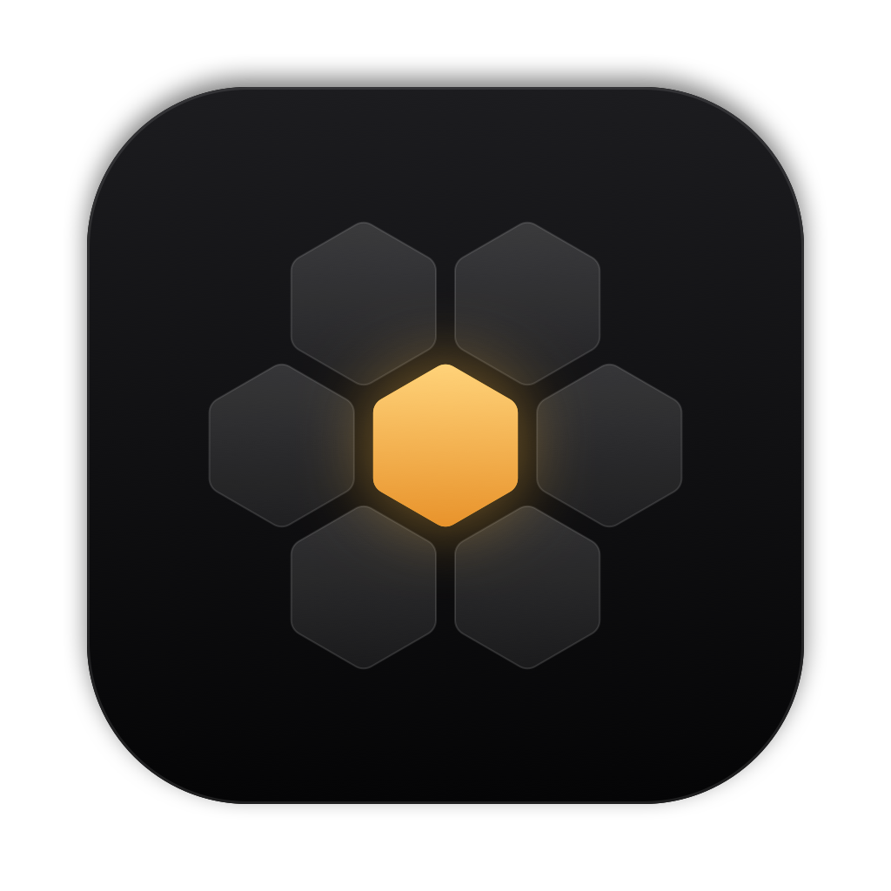
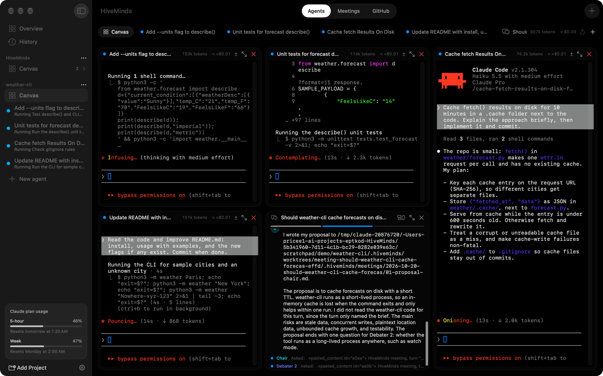
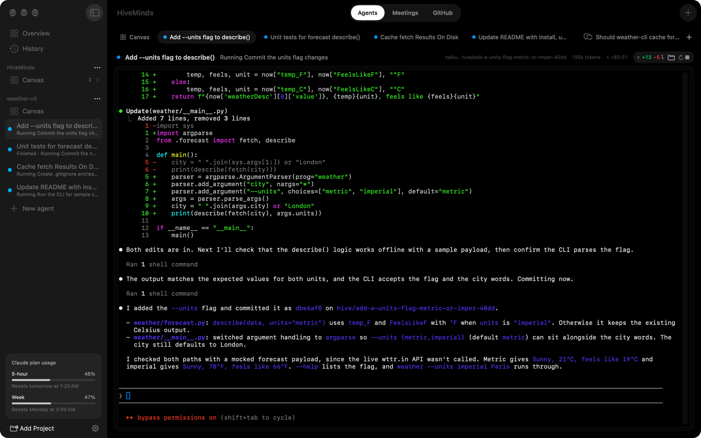
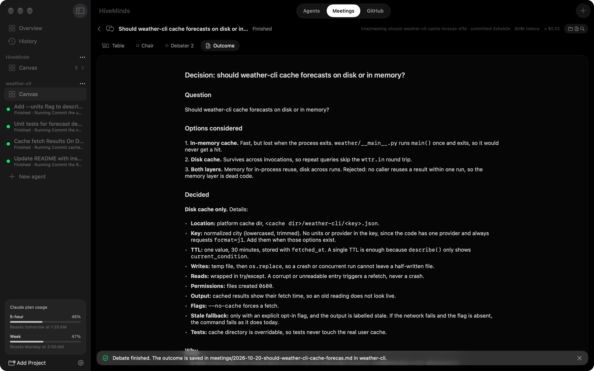
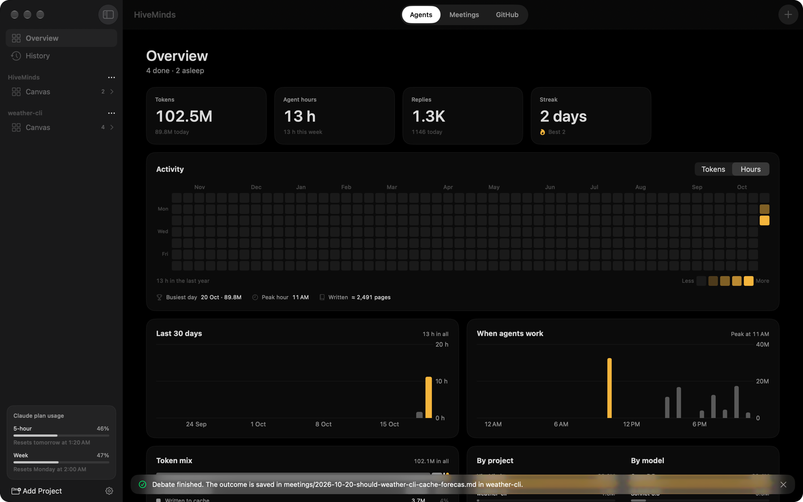
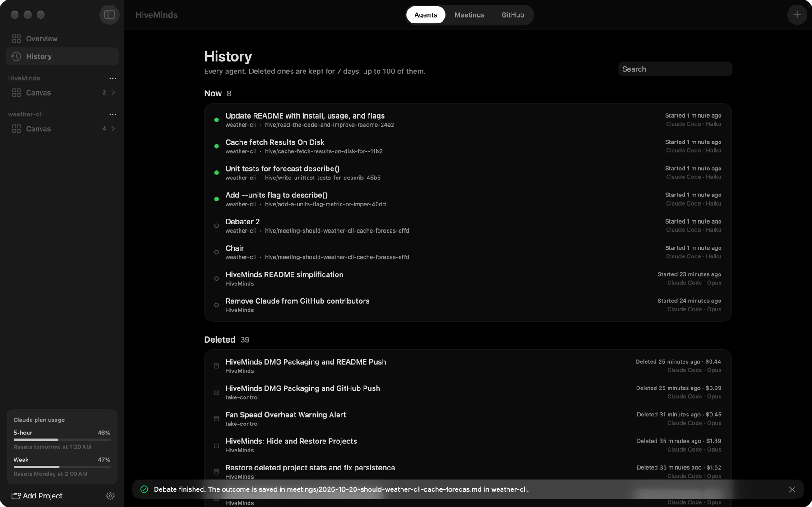

<p align="center">
  <picture>
    <source media="(prefers-color-scheme: dark)" srcset="branding/logo/wordmark-dark.svg">
    <source media="(prefers-color-scheme: light)" srcset="branding/logo/wordmark-light.svg">
    
  </picture>
</p>

<p align="center">A calm, native macOS app for running Claude Code and Codex agents across your projects.</p>

<p align="center">
  
</p>

<p align="center">
  <a href="https://github.com/eptkod/HiveMinds/releases/latest"><b>Download for macOS</b></a>
</p>

<p align="center">
  
</p>

## What it is

If you run more than one coding agent at a time, the terminal windows pile up fast. HiveMinds puts them all in one quiet, black window. Each project gets its own space, and you can see every agent working at once, step in when one needs you, and review what it changed before it goes anywhere.

## What you can do

### See everything at once

The **Canvas** shows every agent, browser tab and shell in a project side by side, and each one works right there. Drag tiles around, make the important ones bigger, and HiveMinds tells you (with a sound, if you like) when an agent finishes or needs an answer. Permission prompts, questions and plans to approve can be answered right on its tile, or on its card in the Overview, without opening the terminal.

### Give each agent its own branch

An agent can work on its own copy of the project, so several can change code at the same time without stepping on each other. When it's done, look at what it changed, then let HiveMinds write the pull request. Nothing is pushed until you say so.

<p align="center">
  
</p>

### Hand over a whole list

Found six bugs while play-testing? In New Agent, switch to **Split up** and paste the whole list, screenshots included. HiveMinds takes a quick look at the code, groups the bugs that touch the same files, and starts one agent per group, each on its own branch with the cheapest model that will do the job. They show up on the Canvas a few seconds later.

### Hold meetings

Ask a few agents to debate an idea or review some code together. They take turns, and you get a written summary of what they agreed on.

<p align="center">
  
</p>

### Turn GitHub issues into work

Sign in with the GitHub CLI and HiveMinds lists the open issues across your projects. Pick one, and an agent starts on it. Its pull request closes the issue when it's merged.

### Keep an eye on cost

Every agent shows its tokens and an estimated cost. The Overview charts your activity, and you can see how much of your Claude plan's 5-hour and weekly limits you've used.

<p align="center">
  
</p>

### And a few more things

- **History:** every agent you've run, including ones deleted in the last week, so you can pick an old conversation back up.
- **Voice dictation:** hold Right Option and talk instead of typing, or press Right Option + Space to keep listening hands-free and tap Right Option to finish. If the words miss, ⌥⌘V types them again. It runs on your Mac. Off until you turn it on.
- **Stay awake:** keep the Mac from sleeping while agents are still working.
- **Region check:** optional. On Wi-Fi, at startup and whenever your network changes (say a VPN turns off), HiveMinds looks up the country of your internet address (never your precise location). If Claude or Codex isn't offered there, it stops every agent and lets you quit or turn the check off.
- **Tidy sidebar:** drag projects into the order you like, and hide the ones you're done with.
- **Light on your Mac:** native SwiftUI, no busy animations, and nothing running when you're idle.

<p align="center">
  
</p>

## Install

1. Download `HiveMinds-<version>.dmg` from the [latest release](https://github.com/eptkod/HiveMinds/releases/latest).
2. Open it and drag HiveMinds into Applications.
3. The first time, right-click HiveMinds and choose **Open**. The app isn't notarised yet, so macOS asks once.

If macOS still won't open it, run this in Terminal:

```sh
xattr -dr com.apple.quarantine /Applications/HiveMinds.app
```

**You'll need** macOS 26 or later, [Claude Code](https://docs.claude.com/en/docs/claude-code) (Codex is optional), and the [GitHub CLI](https://cli.github.com) for the GitHub features.

## Handy shortcuts

| Shortcut | What it does |
| --- | --- |
| ⌘P | Jump to any project, agent, tab or meeting |
| ⌘G | Open the project's Canvas |
| ⌘J | Go to the agent that needs you |
| ⌘T | New browser tab |
| ⇧⌘T | New shell in the project's folder |
| ⇧⌘N | New meeting |
| ⌘Y | Agent history |
| ⌘, | Settings |

## Build from source

You only need the Command Line Tools, not the full Xcode.

```sh
scripts/build-app.sh      # builds build/HiveMinds.app
open build/HiveMinds.app
scripts/build-dmg.sh      # packages build/HiveMinds-<version>.dmg
```

Use `scripts/build-app.sh debug` for a debug build while you work, and `scripts/test-core.sh` to run the tests of `HiveMindsCore`, the agent logic shared with the Linux host (it also builds and tests on Linux with plain `swift test`). The terminal emulator, SwiftTerm, is kept in `Vendor/` with a small patch; see `Vendor/README.md`. To publish a release, follow the release protocol in `CLAUDE.md`. Run `git config core.hooksPath scripts/hooks` once after cloning to turn on the commit-message hook.

## HiveMinds Host (in progress)

`hiveminds-host` runs projects and agents on another machine (Linux first, it also runs on a Mac) with no window, for the HiveMinds app to use over the local network. The plan is in `docs/LINUX-HOST-SPEC.md` and the protocol in `docs/HOST-PROTOCOL.md`. It listens on the local network only, announces itself, pairs devices with a 6-digit code and your yes, and runs their agents. In HiveMinds, hosts on your network show in the sidebar under "On this network": press Pair…, type the code the host shows and say `y` on the host. Its projects then appear under This Mac, and New Agent in one of them runs the agent there. Settings > Hosts lists paired hosts and pairs by address. The AUR package is ready but not published yet.

To try it from source (Swift 6 on Linux, or Command Line Tools on a Mac):

On Arch or CachyOS, once it's published, install the AUR package `hiveminds-host-bin`; the prebuilt binary needs no Swift. To try the package before that, build the tarball (below), copy it into `packaging/aur/hiveminds-host-bin/` as `hiveminds-host-bin-<version>.tar.gz`, and run `makepkg -si` there. It prints the setup steps: add a project, `systemctl --user enable --now hiveminds-host`, `sudo loginctl enable-linger $USER` to keep it running when you're logged out, and `hiveminds-host pair` for the code. On another Linux, use the tarball from the GitHub release; its `README.txt` says how.

To build the Linux binary yourself: `scripts/build-host-linux.sh` on a Linux machine with Swift makes `build/hiveminds-host-<version>-linux-<arch>.tar.gz`. On an Apple silicon Mac, `scripts/build-host-x86_64.sh` makes the x86_64 one in the Lima VM (`HANDOFF.md`, "Building and testing") and updates `packaging/aur/`.

To run it from source:

```sh
swift build -c release --product hiveminds-host     # Linux: add --static-swift-stdlib for a binary that runs without Swift installed
.build/release/hiveminds-host projects add ~/code/my-game
.build/release/hiveminds-host serve                 # shows its address and a pairing code; Ctrl+C stops it and its agents
.build/release/hiveminds-host status                # from another terminal
.build/release/hiveminds-host devices list          # paired devices; `devices revoke NAME` removes one
.build/release/hiveminds-host log --follow          # the audit log
```

On Linux, discovery uses Avahi (`avahi-daemon` running, and its `libdns_sd` library, which Arch and CachyOS's `avahi` package include). Without it the host still works; devices connect by address. A host started without a terminal (systemd) shows pairing codes in `hiveminds-host pair`.

Checks: `scripts/test-app-remote.sh` (the app against a local host), `scripts/test-host.sh` (agents, stopping; `--real` uses the real Claude Code with Haiku) and `scripts/test-host-network.sh` (pairing, the defences, two devices sharing an agent; on Linux add `--non-private <address>`). To test on a Linux machine, `scripts/copy-to-linux.sh user@address` copies the source over SSH; `docs/HOST-TESTING.md` walks through a full test on CachyOS, including trying it from the Mac.

## Learn more

- [The guide](docs/GUIDE.md): where HiveMinds keeps its files, how branches, meetings and pull requests work, and how to test features.
- [Branding](branding/README.md): the logo, icon and colours.
- [HANDOFF.md](HANDOFF.md): the plan, decisions and progress.

More games and apps by eptkod, including free browser games, are at **[home.eptkod.com](https://home.eptkod.com/)**.

## Licence

MIT, so you can reuse the code as long as you keep the copyright notice (`LICENSE`). The libraries built into the app and the host have their own licences, listed in `THIRD-PARTY-NOTICES.txt` inside each download.
